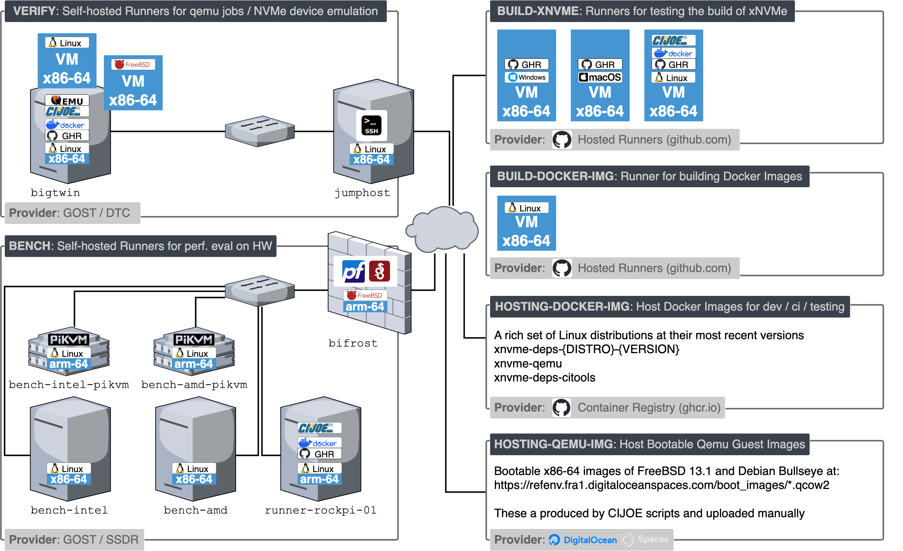

.. _sec-ci:

####
 CI
####

An overview of the environments and the virtual, and physical resources
utilized for the **xNVMe** **CI** is illustrated below.

   **xNVMe** **CI** environments and resources

The above figure is outdated, as **bench** and **verify** have been migrated
to a MaaS provider and are no longer on-premises. However, one system remains
on-prem because no MaaS provider currently offers a suitable replacement.

.. _sec-ci-infrastructure:

Infrastructure
##############

The main logical infrastructure component for the **xNVMe** **CI** is `GitHub
Actions`_ (**GHA**). **GHA** handles **events** occuring on the following
repositories:

* https://github.com/xnvme/xnvme/
* https://github.com/xnvme/xnvme.github.io
* https://github.com/xnvme/xnvme-docker
* https://github.com/xnvme/dpdk-windows-drivers

And decides what to execute and where. In other words **GHA** is utilized as a
**resource-scheduler** and **pipeline-engine**. The **executor** role is
delegated to `CIJOE`_ for details, then have a look at `CIJOE in xNVMe`_.

The motivation for this separation is to make it simpler to reproduce build,
test, and verfication issues occuring during a **CI** run, using locally
available resources, by executing the `CIJOE in xNVMe`_ workflows and scripts.

.. _sec-ci-jobs:

Jobs
####

The jobs performed by the **xNVMe** **CI** catch the following issues during
integration of changes / contributions:

* Code format issues

  - Linting and code-formating
  - clang-format for C
  - clippy for Rust
  - black / ruff for Python

* Build issues

  - Build with debug enabled and disabled
  - Detect linking issues with both the static and shared library
  - Tested on every OS listed in the :ref:`sec-toolchain` section
  
* Functional regressions

  - Running logical tests exercising all code-paths
  - Using a naive "ramdisk" backend
  - Using emulated NVMe devices via qemu
  - Using physical machines

In addition to cathing issues, then the CI is also utilized for:

* Benchmarking of **xNVMe**

  - Using physical machines
  - Measure peak IOPS for a single physical CPU core
  - Specifically for the integration of **xNVMe** in SPDK (``bdev_xnvme``)

* Statically Analyze the C code-base

  - CodeQL via GitHub
  - Coverity

* Produce and deploy documentation

  - Run all example commands (``.cmd`` files) and collect their output in
    ``.out`` files
  - Render the Sphinx-doc documentation as **HTML**
  - Upload rendered documentation to `xnvme.io via GitHub-pages`_

These following sections provide system-setup notes and other details for the
various **CI** jobs.

.. _sec-ci-sources:

Where the devices come from, and which guest runs what
######################################################

A verification job gets its NVMe devices from one of three sources:

* **emulated**: **QEMU** and the vfio-user device servers in `xnvme-devenv`_'s
  host container, on a GitHub-hosted runner, with the guest booted on a rig
* **passthru**: a lab machine's real drive, passed by vfio-pci to a guest
  booted in the same host container, on the lab machine
* **physical**: the machine's own OS, with no guest (the macOS machine)

The guest follows what is verified. Debian 13 is kept upstream-pure, a stock
kernel and in-tree drivers only, and verifies the transports on a kernel users
run.

.. list-table:: What runs where
   :header-rows: 1
   :widths: 22 30 26 22

   * - Verifies
     - Emulated
     - Passthru
     - Physical
   * - NVMe/PCIe
     - ``verify``: Debian 13 with the IOMMU on and off, FreeBSD 14; rig
       ``storage-node-emulated``
     - ``verify-maas``: Debian 13 on the lab machine; rig
       ``storage-node-passthru``
     - ``verify-physical``: macOS 14, through MacVFN
   * - NVMe/TCP
     - ``verify``: Debian 13, the kernel and SPDK initiators
     - none
     - none

A cell that says none has no job: that subject is not verified from that
source.

The benchmarks run on the passthru machines, weekly and on request, outside
``ci-result``.

.. _sec-ci-environments:

Containers and guest images
###########################

The emulated **CI** jobs and ``docgen`` run inside a Docker host container
(set by **GHA**'s ``container:`` directive), and boot a **QEMU** guest as part
of their work. The host container comes from `xnvme-devenv`_, which adds the
vfio-user device servers to a `nosi`_ base; the guest images come from
`nosi`_ itself.
Both publish **OCI** artifacts on **GHCR**.

* **Host containers** carry the toolchain the **GHA** job itself uses: **QEMU**
  binaries, **CIJOE**, devbind / hugepages helpers, and ``vfu_kvssd``. They
  also carry the rigs a guest boots with, its PCIe topology and NVMe
  controllers, and the scripts that boot them. The **QEMU** jobs boot
  ``storage-node-emulated``; ``make guest-start RIG=<rig> ...`` takes others,
  rig names or files, each layered over the one before.

* **Guest disk images** are the qcow2 boot disk the in-job **QEMU** instance
  runs. They are pulled in-job by the ``stage_nosi_guest`` **CIJOE** script
  (invoked from ``guest.yaml`` right before ``guest_initialize``), which
  talks directly to the
  **OCI** Distribution API via stdlib ``urllib`` (no ``oras`` CLI dependency);
  the blob digest is pinned as ``oras.url`` under
  ``[system-imaging.images.<name>]`` in ``cijoe/configs/system_imaging.toml``.
  The nosi guests ship with root locked and an operator account ``odus``;
  ``cijoe/scripts/root_unlock.py`` runs right after ``guest_start`` to open
  root **SSH** so the rest of the **CIJOE** workflow continues as root unchanged
  (Linux uses ``chpasswd`` + ``systemctl``, FreeBSD uses ``pw usermod`` +
  ``service sshd reload``).

.. list-table:: Per-job container + guest-image inventory
   :header-rows: 1
   :widths: 28 32 32

   * - Job
     - Host container
     - Guest disk image
   * - ``verify (debian, trixie)``
     - ``xnvme/xnvme-devenv/host`` (upstream QEMU + CIJOE + vfu_kvssd)
     - ``safl/nosi/debian-13-headless``
   * - ``verify (debian, trixie-noiommu)``
     - ``xnvme/xnvme-devenv/host`` (upstream QEMU + CIJOE + vfu_kvssd)
     - ``safl/nosi/debian-13-headless``
   * - ``verify (freebsd, 14)``
     - ``xnvme/xnvme-devenv/host`` (upstream QEMU + CIJOE + vfu_kvssd)
     - ``safl/nosi/freebsd-14-headless``
   * - ``verify-maas (debian, trixie)``
     - ``xnvme/xnvme-devenv/host`` (QEMU, CIJOE), on the MAAS runner
     - ``safl/nosi/debian-13-headless``
   * - ``benchmark-bdev_xnvme``
     - ``xnvme/xnvme-devenv/host`` (QEMU, CIJOE), on the MAAS runner
     - ``safl/nosi/debian-13-headless``
   * - ``benchmark-latency (linux)``
     - ``xnvme/xnvme-devenv/host`` (QEMU, CIJOE), on the MAAS runner
     - ``safl/nosi/debian-13-headless``
   * - ``benchmark-latency (freebsd)``
     - ``xnvme/xnvme-devenv/host`` (QEMU, CIJOE), on the MAAS runner
     - ``safl/nosi/freebsd-14-headless``
   * - ``benchmark-latency (windows)``
     - ``xnvme/xnvme-devenv/host`` (QEMU, CIJOE, swtpm), on the MAAS runner
     - Windows 11, from the Hetzner Storage Box, on the runner
   * - ``docgen``
     - ``xnvme/xnvme-devenv/host`` (upstream QEMU + CIJOE + vfu_kvssd)
     - ``safl/nosi/debian-13-headless``

All container-hosted jobs run in the `xnvme-devenv`_ host container, with
upstream **QEMU**; the NVMe KV command set is supplied by `vfio-user-kvssd`_
over **vfio-user**, installed in the container. ``verify-maas`` and the
benchmarks run the container on the lab machine, and pass its drive through
with ``PASSTHRU=0000:02:00.0``; they mount the machine's
``/home/ghr/system_imaging``, so a guest image is staged once per machine, and
the Windows image, which cannot be distributed, is there.

.. _sec-ci-devenv:

Reproducing a job, and developing in it
#######################################

The emulated jobs run the same make targets you run locally, in the same host
container; :ref:`sec-tutorials-devs-linux-reproduce-ci` describes them.

.. toctree::
   :maxdepth: 2
   :hidden:
   :includehidden:

   runners/hetzner-setup/index.rst
   runners/onpremise/index.rst
   misc/index.rst

.. _CIJOE in xNVMe: https://github.com/xnvme/xnvme/tree/main/cijoe
.. _CIJOE: https://cijoe.readthedocs.io
.. _GitHub Actions: https://github.com/features/actions
.. _nosi: https://github.com/safl/nosi
.. _xnvme-devenv: https://github.com/xnvme/xnvme-devenv
.. _vfio-user-kvssd: https://github.com/safl/vfio-user-kvssd
.. _xnvme.io via GitHub-pages: https://github.com/xnvme/xnvme.github.io
